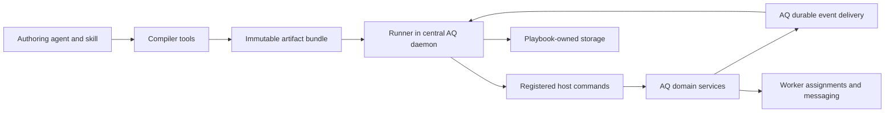

# aq-playbooks design

**Status:** Draft with the agreed minimal command surface  
**Date:** 2026-10-30  
**Implementation language:** Rust  
**Repository:** `aq-playbooks`

Related designs: [SDLC policy exploration](../research/2026-10-30-sdlc-policy-exploration.md), [AQ foundation](../../../agent-q/docs/specs/0001-infrastructure-foundation.md), [worker framework](../../../aq-worker/docs/specs/0001-worker-framework.md), [aq-git](../../../aq-git/docs/specs/0001-aq-git.md), and [aq-graph integration](../../../aq-graph/docs/aq-integration.md).

The [v1 capability selection](../research/0001-v1-to-v2-capability-selection.md) provides the evidence for the twelve-command host surface and reusable workflows adopted here. The existing command inventory is not a compatibility checklist.

## 1. Purpose and design direction

aq-playbooks turns project policy into repeatable, inspectable workflows. A policy describes what should happen when an event occurs or a workflow is requested, which evidence and decisions are required, and how to respond when the normal path fails. The engine provides durable coordination. Its host supplies the commands, events, authority, and domain services.

An authoring agent translates natural-language Markdown into a structured proposal using a skill and discovery/validation tools. A deterministic compiler validates and packages that proposal. The runner executes the immutable artifact without reinterpreting its prose. Natural-language translation is an inference step; the compiler cannot prove that an interpretation captures every intention in the source.

Playbooks can call other playbooks, wait for their results, start owned work and join later, or launch independent workflows. This supports small, reusable policies for review, validation, repair, integration, and monitoring instead of one project-sized graph.

The baseline is a separately released Rust repository containing a library and CLI. AQ embeds the runner in its central daemon. Supervisor agents remain central, and worker nodes keep their outbound assignment and messaging model. There is no requirement for another workflow server, message broker, model service, or worker-side policy engine.

The initial AQ policy API contains twelve concrete commands. Spec ingestion, review, repair, reporting, and monitoring compose those commands through reusable playbooks. Additional domain effects are optional registrations; a new cadence, reviewer role, or task template ordinarily reuses the existing API.

### Requirements

| ID | Requirement |
| --- | --- |
| P1 | Natural-language authoring is supported through an agent skill and tools; deterministic compilation accepts an explicit structured proposal. |
| P2 | Compiler and runner are independently testable components sharing a versioned artifact model. |
| P3 | Commands and events are registered through public, typed contracts with no AQ source dependency in the engine. |
| P4 | Runs pin immutable definitions and callable dependencies; source edits do not change running behavior. |
| P5 | Event admission, run progress, waits, timers, operation intents, and child creation have durable boundaries. |
| P6 | External effects have declared idempotency/reconciliation behavior; unknown outcomes never become implicit failures or successes. |
| P7 | Call-and-wait, start-and-join, and independent sub-workflows are supported with explicit ownership. |
| P8 | Branching, bounded iteration, parallel joins, deadlines, and bounded retries use deterministic transition semantics. |
| P9 | Caller authority, scope, and capability restrictions survive calls, waits, and recovery. |
| P10 | Evidence and decisions retain their applicable subjects and revisions; the engine does not manufacture domain truth. |
| P11 | Cancellation distinguishes intent, confirmed stopping, late results, and unresolved external operations. |
| P12 | Simulation exercises the same workflow semantics with fake effects and an injected clock. |
| P13 | Normal execution requires no new deployed infrastructure beyond the host's persistence choice. |
| P14 | The project owns its persistence schema and tests; it does not read AQ, aq-graph, aq-worker, or aq-git private state. |
| P15 | Runtime cost is bounded by explicit queue, run, iteration, child, payload, and retention limits. |
| P16 | Operators can explain a run's decisions, waits, child tree, pending effects, and required recovery. |
| P17 | The initial AQ pilot covers coding/integration, routing judgment, a stuck-work watcher, and a supervisor report without requiring deployment or stream-processing features. |
| P18 | Existing AQ v1 behavior and data are references rather than mandatory compatibility or migration targets. |
| P19 | The initial AQ host surface has twelve concrete commands; command variants and context views are finite, documented, and counted as API surface. |
| P20 | Monitoring uses a host-owned findings capability with complete observations, revision-checked episodes, and atomic notification intents; arbitrary cross-run policy state remains deferred. |
| P21 | Reusable sub-workflows replace specialized workflow verbs and duplicated graphs; optional capability packs require an explicit domain need. |

## 2. Boundaries and authorities

| Component | Owns |
| --- | --- |
| Authoring skill and agent | Interpreting prose, discovering capabilities, proposing a graph, exposing assumptions, and preparing scenario tests |
| Compiler | Parsing the proposal, validating semantics/contracts, reporting diagnostics, and producing canonical artifact bytes |
| Runner | Run progress, workflow variables, waits, timers, child ownership, recorded inputs/results, and outgoing operation intents |
| Host adapter | Authenticated admission, capability bindings, command dispatch, event delivery, artifact/source access policy, and protected data access |
| AQ daemon and supervisors | Work and execution policy, assignment authority, messaging, agent profiles, budgets, and human interaction |
| AQ findings and observation services | Scoped complete observations, finding episodes, reminder/suppression state, and durable notification intents |
| aq-graph through AQ | Domain task dependencies, task/knowledge records, and their versioned APIs |
| aq-worker | Local execution, workspace lifecycle, capacity, polling, process ownership, and source handoff |
| AQ integration and aq-git | Candidate and source-control operations, publication preconditions, evidence sufficiency, and retained code |
| Optional release/data adapters | Deployment exclusion, rollout operations, migration checkpoints, observations, and operation reconciliation |

The runner's workflow graph is distinct from AQ's task dependency graph. It may request a task graph change, but the host validates and applies it. A passing workflow step cannot bypass task readiness, evidence requirements, assignment ownership, or publication preconditions.

The runner stores the observations it used, including versions and provenance, as history. It does not treat that history as the current authoritative state of a task, branch, environment, or worker. A state-dependent mutation carries preconditions checked by its owner at execution time.

Review findings, check results, and authorized decisions have different contracts. A review agent completing work does not itself approve the reviewed change. Recording a document does not attest that its contents are true. Notification acceptance is distinct from delivery and acknowledgment.

## 3. Repository and deployment

### Components

| Proposed crate | Responsibility |
| --- | --- |
| `aq-playbooks-model` | Artifact types, expression/value types, registry manifests, versioned envelopes, canonical serialization, and structural verification |
| `aq-playbooks-compiler` | Source/proposal processing, semantic validation, dependency/interface checks, diagnostics, semantic diff, and packaging |
| `aq-playbooks-runner` | Transition evaluation, lifecycle, events/waits/timers, durable effects, sub-workflows, simulation, and inspection projections |
| `aq-playbooks-postgres` | Production storage implementation, private schema migrations, atomic boundaries, and persistence conformance tests |
| `aq-playbooks-cli` | Authoring, offline validation/simulation, and administration through an explicitly selected runtime or store |

The runner depends on the model, not the compiler. It verifies artifact integrity and runtime compatibility without importing natural-language authoring machinery. The storage adapter depends on runner storage contracts; the runner does not depend on PostgreSQL internals.

Commands are registered Rust host implementations initially. An adapter may call another service through that service's public API, but dynamically loaded native plugins and a general remote-executor protocol are outside this first pass. Registration does not mean the runner downloads or executes arbitrary extension code.

### Persistence choice

The proposed baseline uses the PostgreSQL service already required by AQ, with an independently owned schema and migration history. This avoids inventing a file transaction engine for receipts, waits, events, and children. It adds a library/storage dependency, but no additional database server to an AQ deployment.

Compilation, artifact inspection, and simulation run without a database. Core correctness tests use an in-memory implementation of the same atomic storage contract. Persistence and crash tests use a disposable PostgreSQL database without an AQ daemon. A standalone durable installation initially needs PostgreSQL; an embedded file database is a future option if zero-service durable execution becomes a requirement.

Even when components share a database server, aq-playbooks does not join or update another component's tables, share its migration ownership, or rely on a transaction spanning host domain state and workflow state. Integration uses durable handoffs.

### Execution topology

One active runner owns a configured engine namespace in the initial release. The storage adapter acquires an ownership lock and records a runtime incarnation. CLI writes go through that owner, or require exclusive ownership when it is stopped. Losing ownership stops new dispatch; already-issued external effects remain subject to idempotency and reconciliation. This is a single-owner deployment model, not a distributed high-availability guarantee.

The host must retire the previous runner before starting a replacement. Database ownership prevents accidental concurrent writers; it does not claim to fence arbitrary external systems against a partitioned process. Multi-host failover would require an additional end-to-end fencing contract.

## 4. Authoring and compilation

### Source and structured proposal

Markdown is the authored explanation of policy. A small structured header identifies the playbook, source format version, scope category, and declared callable interfaces or named project definitions. Exact header syntax is left to the implementation specification.

The semantic proposal contains triggers, entry points, typed steps, expressions, transitions, dependency references, and limits. It may be written directly or produced by an agent. The compiler never asks a model to fill gaps during packaging.

For example:

> When a change is ready, start documentation review while preparing its candidate. Validate that candidate. Wait for both reviews and validation before requesting publication. If validation reports an infrastructure failure, retry once. If a repair is needed, call the repair workflow and validate the resulting candidate again, at most twice.

An authoring agent must establish what “ready,” “reviews,” and “infrastructure failure” mean using project definitions and registered contracts. It cannot silently invent authority, a test suite, or an approval rule. Unresolved consequential choices remain diagnostics/questions in the proposal.

Named project definitions used by compilation are captured by version or digest in the artifact. A definition intentionally read at runtime is an explicit observation with recorded results; it cannot silently change the meaning of a supposedly fixed constant.

### Skill and tool surface

The repository will ship an authoring skill usable by supported agent harnesses. It teaches discovery, proposal construction, scenario design, interpretation review, and activation separation. Tools expose:

- Command and event catalogs with individual schema/contract descriptions.
- Callable playbook interfaces and compatible dependency versions.
- Proposal validation with precise source/step diagnostics.
- Scenario simulation using fake command responses, events, and time.
- Artifact/interface/behavior diffs against a prior version.
- Deterministic packaging of an exact proposal and its inputs.

The skill is an authoring aid, not a source of runtime authority. A malicious source document cannot grant commands by describing them. The host decides which registry entries and capabilities are available to an author and to execution.

### Deterministic compiler pipeline

1. Parse the source header and structured proposal under a declared format version.
2. Bind the exact source digest, named definitions, command/event manifests, and callable interfaces.
3. Check schema conformance, reference resolution, input/output compatibility, reachable transitions, explicit unknown/error handling, bounded loops, child-call topology, and required capabilities.
4. Reject unsupported features and unconditional recursion. Report unresolved interpretation questions separately from structural errors.
5. Produce canonical executable content, source mappings, diagnostics, and a dependency/interface manifest.
6. Package the validated artifact and optional scenario fixtures for inspection and installation.

Identical normalized source bytes, structured proposal, captured definitions/manifests, and compiler build produce identical artifact bytes. Normalization is deliberately narrow: UTF-8 text with defined line endings. Semantic equivalence of different prose is not assumed. Nondeterministic build timestamps and model conversation logs belong in an external provenance record, not the hashed executable artifact.

The model crate defines one canonical JSON encoding. Object keys are ordered; finite numeric forms, string encoding, defaults, absence, and null have explicit rules and golden vectors. Cross-language consumers must use that contract rather than assuming their default JSON serializer produces identical hashes. Decimal domain quantities may use schema-defined strings where exact decimal semantics are required.

Full artifact identity covers the source binding and executable definition. A separate executable fingerprint permits a diff to identify presentation-only changes. Either kind of edit produces a distinct full artifact when its hashed content changes; no bytes are replaced under an existing hash.

Compilation proves structural validity and compatibility with the captured interfaces. It does not prove policy correctness, external command implementation correctness, or faithful interpretation of prose. Scenario traces and readable semantic diffs make those questions reviewable.

## 5. Artifact and activation model

An artifact contains:

- Format/compiler identifiers, source digest, identity, and a human-readable purpose.
- Callable entry points with input schemas, output schemas, and declared business outcomes.
- Optional event-trigger rules mapping an event into an entry point's inputs.
- Typed steps, expressions, explicit transitions, bounded retry/loop policies, and limits.
- Required command/event contracts and capability requirements.
- Statically named child interfaces and version constraints, including call mode.
- Captured project definitions and source mappings.

Artifact hashes are immutable addresses. Installed source documents, compiled artifacts, active trigger subscriptions, callable bindings, and run state are different records with different owners and lifetimes.

Source edits produce proposals. Installation stores verified artifacts. Activation changes which artifact serves a named callable binding and which triggers are enabled. These are explicit operations. A host may authorize automatic activation for a category of policy; the engine does not impose universal human approval or silently activate source edits.

A callable-only playbook needs no event trigger. Disabling its triggers does not disable calls. Administrative controls distinguish stopping new calls, stopping event starts, and revoking execution authority. Revocation can block existing effects without rewriting an artifact or pretending a running external operation was canceled.

An admitted root run freezes a manifest of exact artifact hashes for its entire statically reachable call graph, including independent starts. Resolution uses a consistent callable-catalog revision and checks interface compatibility, scope, availability, and cycles. The manifest and retention references commit with root admission. A child uses the root's captured dependency bindings, so a later activation cannot change the child's grandchildren.

The manifest exposes transitive capability requirements for inspection and admission. Resolving a child does not grant those capabilities automatically: the caller's authorized ceiling must cover the requested execution. Interface-compatible child updates that require additional capabilities can therefore be refused at new-run admission without affecting retained artifact identity.

Current authority is still checked when a child or command begins. A pinned version is reproducible code, not a permanent grant. Removed/revoked capabilities produce a visible blocked or refused operation. Pinned artifact bytes remain retained while a run may need them.

Dynamic selection of child playbooks and migration of active runs to new artifacts are deferred. A new root invocation resolves current bindings; an existing root keeps its captured ones.

## 6. Extension contracts

### Command registration

A command contract identifies a namespaced command and explicit semantic version/fingerprint. It declares:

| Field group | Meaning |
| --- | --- |
| Inputs and outputs | Bounded schemas and named outcomes; distinguish admission responses from eventual business results |
| Authority | Required capabilities, supported scope, actor restrictions, and host-checked preconditions |
| Effect classification | Observation or mutation; read-only does not mean deterministic or free of confidential data |
| Recovery | Pure/re-readable, naturally idempotent, keyed idempotent, reconcilable, or unsafe to replay automatically |
| Asynchrony | Durable operation handle, completion schema/event, status/reconciliation binding, and correlation requirements |
| Cancellation | Whether cancellation is supported, the authorized operation, and accepted/refused/too-late/confirmed meanings |
| Data handling | Public receipt projection, sensitive fields, external artifact references, and payload limits |
| Resource behavior | Admission limits, declared deadlines, and applicable accounting metadata |

A host implementation binds to that exact executable contract. Presentation changes need not invalidate it. A breaking contract requires a new version/fingerprint and deliberate rebinding. A run never silently executes an incompatible implementation because its command name still exists.

The runner validates inputs and results, but the host independently enforces current authorization, object ownership, expected versions, and domain invariants. A declared `retry_safe` flag is a contractual guarantee requiring adapter tests, not something the compiler can prove.

### Event registration

An event contract declares its name/version, bounded payload schema, trusted producers, scope rules, subject/correlation fields, and interpretation of revisions or sequence numbers. The authenticated producer is separate from producer fields in JSON.

The envelope includes stable producer/event identity, schema version, subject identity/revision where applicable, scope, causation, and observation/occurrence times when meaningful. Events do not carry arbitrary execution authority. Agent-visible emit commands are restricted to authorized signal types; task completion, deployment results, and human decisions come from their authoritative services.

### Initial AQ host API

| Command | Contract |
| --- | --- |
| `context.read` | Read a registered typed view of work context, project context, execution options, evidence, or health observations. Return bounded snapshots/pages with versions, freshness, scope, and completeness. |
| `work.ensure` | Idempotently request a bounded work item or validated work graph from versioned inputs, acceptance conditions, dependencies, and execution constraints; return work and operation references. |
| `work.change` | Apply a checked change to requirements, priority, dependencies, execution constraints, or individually owned holds, using applicable expected revisions and evidence references. |
| `judgment.request` | Request a bounded model assessment against explicit context and a declared output schema; return a durable operation handle. The host selects a permitted execution profile. |
| `decision.request` | Ask eligible decision makers a structured question bound to an exact subject/revision, declared choices, and expiry policy. The host authenticates responses. |
| `check.request` | Execute a registered check against an immutable subject and named execution context; retain typed outcomes and evidence. |
| `candidate.prepare` | Construct an immutable integration candidate from an explicit bounded source set and base; return candidate identity, structured conflict, or refusal. |
| `candidate.publish` | Request conditional publication using the candidate, required evidence, and destination preconditions. The integration host enforces authority and delivery invariants. |
| `message.send` | Submit an identified, scoped notification or report with declared visibility; acceptance, delivery, and acknowledgment remain distinct. |
| `findings.reconcile` | Reconcile a bounded observation partition with durable finding episodes, revision checks, reminders, and atomically recorded notification intents. |
| `operation.get` | Read the authoritative status/result of an admitted asynchronous operation through its owning adapter. |
| `operation.cancel` | Request cancellation through the operation owner; distinguish accepted, refused, too late, confirmed, and indeterminate outcomes where applicable. |

These are concrete contracts, not families that automatically expose every daemon method. The command count excludes engine-native calls, joins, waits, branches, loops, timers, and retries, as well as compiler/administrative CLI tooling. Host services may have larger internal APIs; those do not become playbook capabilities automatically.

`context.read` publishes a finite schema for each supported view. It accepts neither arbitrary SQL nor an arbitrary endpoint name. `work.change` has a closed set of documented variants and cannot patch arbitrary fields, set arbitrary lifecycle states, or manufacture task acceptance. Releasing a hold names the specific hold and its authority. Cancellation uses `operation.cancel`; domain services own acceptance and delivery.

`work.ensure` uses declared work kinds and output contracts for implementation, investigation, planning, review, repair, and supervisor authoring. It can atomically materialize a bounded proposed graph only after AQ validates its dependencies, scope, source-bound decisions, and admission requirements. A caller-supplied approval flag is insufficient. Results and evidence are recorded by their owning services, so the initial playbook API does not also expose a general artifact-write command.

A work request declares its lifetime and what its operation's completion means. Durable creation and completion of the created work are separate observations. Work explicitly requested with an independent lifetime can outlive the requesting workflow; owned work remains subject to the workflow's settlement/cancellation rules. An `ensured` result does not prove a review passed or implementation was accepted.

Routing policies read permitted execution options, obtain a structured judgment when needed, and change authorized work requirements/preferences. AQ still chooses and authorizes the actual execution using current provider availability, capacity, and worker eligibility. The playbook cannot obtain arbitrary credentials, claim a worker lease, or bypass local worker admission.

`judgment.request` supports short assessments without requiring a fully scheduled worker task. The baseline does not grant the assessing model an arbitrary tool loop. Larger investigations and reviews use `work.ensure`. Neither judgment output nor completed review work can substitute for a human-only decision or executed check evidence.

`operation.get` and `operation.cancel` dispatch using a server-owned handle and its registered adapter, never an authored method name. Readback and cancellation recheck authority. Cancellation cannot undo publication; a settled operation returns its existing disposition. Every asynchronous adapter must provide a truthful inspection/recovery contract and declare whether cancellation is supported.

The initial event catalog covers typed variants of `work.changed`, `artifact.recorded`, `operation.changed`, `check.completed`, `decision.resolved`, `integration.changed`, and registered `signal.reported` events. Domain services can emit artifact/evidence events without exposing a general write command. Optional release capabilities add their own registered events. Exact schemas, producers, and correlation fields belong to the host integration specification.

### Findings and complete observations

`findings.reconcile` provides durable monitoring state through an AQ-owned service, without adding a general key/value store to the runner. Its inputs identify a scope/partition, observation and evaluation references, bounded finding keys/evidence, expected episode revisions, and a reminder policy. The host derives sender identity and checks recipient visibility.

The health-observation view of `context.read` includes prior episode identities/revisions and the tokens needed for a bounded observation scan. Where absence requires a pre-scan baseline, those revisions are captured before the diagnostic scan and remain fixed throughout evaluation. Snapshot paging preserves its identity and finite coverage; a partial or expired traversal never appears as a successful empty result.

An episode can become present, remain present without another alert, emit a scheduled reminder, or become cleared. Positive findings can be accepted from a partial scan, but clearing requires verified complete coverage of the relevant partition and the original expected revision. A caller-supplied `complete: true` is insufficient: the host validates the referenced observation/evaluation records, scope, and applicability. A stale clear conflicts; it cannot be retried with a freshly read revision while reusing old absence evidence.

The findings service atomically commits episode changes and outgoing message intents in its own store. AQ messaging accepts those intents idempotently. The runner does not share a transaction with either service or independently maintain their suppression ledger. Retries preserve observation identity, and notification identity/retention prevents duplicate enqueue within the supported replay horizon. This service is an AQ module, not a required additional deployment.

### API growth and optional capability packs

Add a command only when a demonstrated domain effect cannot be expressed through the current contracts and a reusable sub-workflow while preserving authority, atomicity, and recovery. Count context-view schemas, work-change variants, and work templates alongside top-level commands. A small command list must not conceal hundreds of unrestricted operation strings.

Optional capability packs can supply managed jobs/scripts, GitHub interactions, versioned knowledge access, deployment, or specialized experiments. They declare separate grants and conformance tests and remain absent from the default policy catalog. Managed jobs retain pinned inputs, bounded execution/output, and explicit cancellation/recovery; they do not create an unrestricted shell escape hatch.

Profile/plugin/configuration administration, dashboard layout, raw Git mutations, worker leases, pool/workspace repair, daemon lifecycle, and legacy migration are outside the initial ordinary-playbook API. AQ retains its operational tools without automatically registering them for policy execution.

## 7. Workflow language

The language is a bounded control-flow graph with structured looping and composition. The initial semantic operations are:

| Operation | Behavior |
| --- | --- |
| Invoke | Resolve typed inputs, persist an intent, call a registered command, and bind its validated response or operation handle |
| Decide | Select a declared branch from a typed expression; no model call is hidden inside the predicate |
| Wait | Suspend for a correlated event, operation result, or deadline, without occupying agent/worker capacity |
| For each | Iterate a captured finite collection under an explicit maximum and failure policy |
| Call | Invoke a statically named callable playbook in wait, owned-async, or independent mode |
| Join | Await a captured set of owned child/operation handles with declared all/any semantics |
| Return | Produce a declared business outcome and schema-valid output after required owned work is settled |

Serial and parallel iterations share semantics but parallel mode has an explicit concurrency limit. The initial release supports parallelism through owned async calls/operations and bounded joins; it does not require arbitrary concurrent writes to shared workflow variables. Child results bind under distinct handles, and the join constructs an ordered result by declared member identity.

Expressions support literals, typed references, boolean logic, comparisons, existence checks, and bounded collection operations: filter, map, membership, and set difference by an explicitly declared identity. Output ordering, duplicate-key behavior, lexical bindings, and byte/element limits are defined by the model contract. Nested iteration has a configured depth bound; paging can process a finite snapshot without accumulating its full payload in the run. No shell evaluation, arbitrary embedded code, or hidden filesystem/network reads occur during evaluation. Missing is distinct from null; unknown or stale evidence is not a false value that accidentally selects a successful default. A predicate whose required inputs are unresolved takes an explicit unknown path or produces a visible unresolved condition.

Named outcomes choose edges. Every reachable outcome must have a declared edge or a visible catch-all failure policy. Transport errors, invalid output, unavailable authority, deadlines, and indeterminate effects remain distinguishable. An unhandled business outcome fails visibly rather than falling through to success.

LLM judgments, scripts, and agent assignments are host capabilities with typed outputs. The runner does not embed provider clients, spawn tmux, or interpret prose at runtime. A project can request a model assessment and then branch deterministically on its recorded result.

Reconciliation uses bounded repetition over fresh, recorded observations: inspect durable domain state, perform an eligible action, wait/back off, and revisit until settled or a deadline/iteration limit is reached. Events can be wake hints while domain state remains authoritative. The workflow must not create an unbounded chain of child runs to implement polling, reset its business-attempt budget on each wake, or treat an empty incomplete scan as settlement.

## 8. Run lifecycle and atomic boundaries

Run lifecycle states are `admitted`, `running`, `waiting`, `finishing`, `cancelling`, `blocked`, `completed`, `failed`, and `cancelled`. Business outcome is a separate field. A review run can complete with `changes_requested`; that is not an engine failure.

`blocked` means progress requires a missing capability, resolution of an uncertain effect, valid external input, or an authorized recovery decision. It retains its intended continuation and outstanding obligations. `finishing` settles owned children/operations before a successful or failed return becomes final. Terminal states are immutable; repeating work creates a new run linked to its predecessor.

Each durable transition atomically updates the versioned run snapshot and appends a receipt, along with any wait/timer changes, child records, budget reservations, or outgoing intents generated by that transition. Compare-and-swap rejects a competing driver. Side effects execute only after their intents commit and outside the transaction.

The transition evaluator consumes recorded inputs and returns proposed state changes and effects. Runtime-generated IDs, time observations, and race winners become recorded inputs; deterministic replay uses those values. The engine does not claim that concurrent external events have one globally deterministic arrival order.

Wakeups are hints. Durable queues, due timers, pending effects, and accepted events are sufficient to resume after a lost notification or process restart. Waiting runs have no active worker assignment merely because they are waiting.

## 9. Event ingress and subscriptions

AQ records domain state changes and their outgoing event records together where it owns that transaction. Its delivery loop sends stable events through the runner's admission API. aq-playbooks records acceptance before acknowledging it. External producers without atomic state/event publication require an adapter reconciliation strategy with explicit limits.

Event identity is `(producer identity, event ID)`. A duplicate with identical content returns the original disposition. Reusing that identity for different content is an integrity conflict. Acknowledgment means durable admission, not successful workflow completion.

Ingress serves two independent purposes: starting subscribed root workflows and delivering observations to existing waits/operation handles. An event with no root subscription may still complete an existing operation. Durable acceptance records both routing responsibilities, including correlated results that arrive before wait registration; an empty root-destination list never authorizes dropping such a result.

Admission records a snapshot of eligible destinations: activation identity, artifact/dependency bindings, trigger rule, scope, and mapped input. The snapshot is frozen for that event. Creating runs may proceed in bounded pages, with durable progress and per-destination deduplication. A root run key includes event identity, destination activation, and rule identity. Changing activation while a delivery retries cannot add a second accidental run or redirect a partially delivered event.

No matching subscription is a recorded disposition against the captured catalog revision. Replay under different policy requires an explicit replay identity and preserves the original causation; it is not a retry of the same event. Missing artifact bytes or unresolved required bindings produce retained blocked destinations rather than a false no-consumer result. If storage/quota admission fails, the producer receives a retryable refusal and retains responsibility.

Indexed event type/scope lookup selects candidate subscriptions. The runtime does not scan every task, Git repository, or artifact on each event. It rejects invalid schemas and unauthorized producers before allowing a business transition. Domain preconditions at command execution handle facts that change after admission.

## 10. Waits, timers, and ordering

Waits declare accepted event schemas, exact correlation requirements, optional minimum subject versions, a deadline, and result mappings. A wait is tied to a run/step invocation, never just a broad event type such as `task.completed`.

The ingress store retains correlated completions that arrive before their waits are registered. Registering a wait atomically checks admissible retained events and records a fulfillment or an open wait. Operation and child handles make causality explicit; unrelated historical events cannot satisfy a new invocation merely because their names match.

One fulfillment wins through an atomic state transition. Duplicates return the recorded result. Other competing events are retained as late observations when relevant and do not rewrite the winner. Subject revisions and operation identity decide applicability; producer timestamps alone do not establish ordering.

The baseline uses persisted UTC deadlines and trusted storage acceptance time. A completion durably accepted before its deadline remains eligible even if the runner processes it later; one first accepted after expiry is late, even if its producer claims an earlier occurrence. Timer processing consults admitted eligible completions before recording expiry. This rule is explicit so processing backlog cannot manufacture a timeout over an already accepted result.

The storage adapter serializes competing event acceptance/wait expiry sufficiently to preserve that ordering. Tests exercise both races. Recovery can reconcile an external operation after a wait expires, but it does so through an explicit new observation and continuation, not by retroactively editing the timeout receipt.

Delays and simple fixed-interval schedules have stable occurrence IDs and an explicit missed-occurrence policy: skip, coalesce once, or bounded catch-up. Clock jumps and overdue timers are observable. Business-day calendars, holiday rules, and complex time-window aggregation are extensions or later features.

For zoned daily reports and project-health schedules, the initial AQ integration can supply occurrences through a host scheduler adapter. That adapter owns timezone interpretation, daylight-saving behavior, schedule revision, local-date occurrence identity, and restart misfire rules. Policies consume the declared occurrence instead of testing UTC timestamp substrings. Complex calendar arithmetic remains outside the expression language.

## 11. External commands and recovery

The durable command intent contains run/step invocation identity, input digest, exact command contract, applicable scope/authority references, operation identity, expected subject versions, and resource/deadline context. Public receipts contain only the declared safe projection.

Transport retries reuse the same operation ID and payload. A deliberate business retry creates a new invocation identity and consumes its retry allowance. A replay must not silently generate another task, notification, test run, publication, or charge.

| Recovery class | Behavior after a lost response |
| --- | --- |
| Observation | May be re-read if its contract permits; the new observation is recorded and cannot replace evidence already used by a committed transition |
| Keyed/naturally idempotent mutation | Repeat the identical operation according to the host's guarantee |
| Reconcilable operation | Query its authoritative operation status before deciding whether resubmission is safe |
| Unsafe or unknowable effect | Block and request an authorized resolution; do not automatically repeat |

An accepted asynchronous request yields a durable handle. Admission rejection, queued/running state, completed business result, cancellation, and indeterminate state are distinct. The runner may wait for completion events or request a status observation. A completion carries the expected operation identity and schema and must come from an authorized producer.

Recording intent and sending a request do not form a transaction with the external system. The design guarantees durable orchestration and contracted replay behavior, not exactly-once arbitrary external effects.

Recovery decisions are explicit records with actor, reason, observed evidence, and targeted invocation. They cannot manufacture a successful result, change the pinned policy, or expand the original run's authority. If an outcome must be supplied manually, the command's recovery contract defines the required authority and evidence.

## 12. Sub-workflows

### Interfaces and call modes

A callable entry point declares bounded input/output schemas and business outcomes. The compiler verifies the caller's arguments and handling of child outcomes. Callable entry points do not require a fabricated event, and they can coexist with trigger-based entry points in the same artifact.

| Mode | Parent behavior | Child ownership |
| --- | --- | --- |
| Call and wait | Create the child and durably wait for its return | Parent owns the child |
| Start and join later | Create the child, bind a handle, and continue; await it at a later join | Parent owns the child |
| Start independently | Create a new root workflow and continue after durable admission | Independent lifecycle with retained originating-run provenance |

“Blocking” describes the parent's workflow state. It occupies no thread or worker slot while waiting. A child may itself be waiting without any agent running.

Example authored policy:

> Start documentation review and compatibility checks in parallel. Prepare release notes while they run. Before publication, wait for both. If compatibility fails, call the repair workflow and repeat validation once. After successful release, start twenty-four-hour monitoring independently.

### Child admission and identity

Creating a child atomically records the child run, its binding to the captured artifact/dependency manifest, the parent's handle or independent-start receipt, relevant budget reservations, and any parent wait. A crash cannot create a child without the parent's durable invocation identity or record a successful start without a durable child.

The invocation key includes parent run, call site, full loop invocation path, and intentional attempt number. Retrying admission returns the same child. Two intentional calls to the same entry point at different sites or iterations create distinct children.

An independent start follows the same atomic admission rule. Its origin does not grant its parent ownership after admission. It copies the selected dependency closure and retains its own artifact references, so parent archival cannot destroy its execution inputs.

### Joining and return

A join captures a finite participant set and declares `all` or `any`, its accepted outcomes, timeout, and remaining-child policy. `any` must state whether it means any completion or the first outcome satisfying a declared predicate. Failure to obtain a qualifying result is a separate outcome. Tie-breaking uses recorded acceptance order; outputs are keyed by participant identity.

An `any` join never silently abandons remaining owned children. It either continues tracking them for a later join or requests their cancellation. A parent cannot enter a terminal state while owned children or non-transferred asynchronous operations remain unresolved. It enters `finishing`/`cancelling`, or `blocked` when settlement is uncertain. A genuine long-lived follow-up must be started independently from the outset in the baseline.

The child's terminal outcome and outputs are committed before the parent observes completion. Parent wakeup is recoverable from stored state; losing the wakeup does not lose the return. Invalid child outputs are a contract failure, not a successful return with truncated data.

Join handles identify operations; they are not bearer authority. The runner verifies ownership and caller scope before joining, canceling, or exposing protected child results. Multiple parents sharing one child execution and dynamic reparenting are deferred.

### Failures and retries

Child business outcomes select parent branches. Engine failure, cancellation, deadline, unavailable authority, and indeterminate external work remain explicit. A parent wait deadline does not prove the child stopped. Its continuation must settle owned work or remain blocked.

A deliberate retry of a terminal child creates a new child invocation linked to the previous one. Rejoining or recovering the original child preserves its identity. Business retry counters survive restart and cannot reset merely because another event starts a root workflow for the same task; cross-run allowances use an authoritative host attempt record initially.

### Cancellation, authority, and budgets

Canceling a parent requests cancellation of owned children. It does not cancel independently started workflows. Owned children request cancellation of their own children and outstanding effects according to supported contracts. An operation that is too late or unsafe to stop remains visible until reconciled; cancellation does not roll back already-published code or undo arbitrary effects.

Children inherit a ceiling derived from their caller and may only narrow it through their own declared requirements and explicit restrictions. Scope cannot widen through a call. Current host authorization is checked at each effect; a trusted recovery driver does not replace the original caller with its own broader identity.

Each root has execution limits for step visits, total child admissions, nesting depth, concurrent children/effects, stored bytes, and time. Child limits draw from those bounds. Creating an independent root requires an authorized finite allocation under the applicable project/root admission budget; detachment cannot replenish a budget or bypass account quotas. Provider cost and worker-resource enforcement remain host responsibilities.

Statically declared calls, including independent starts, must form an acyclic dependency graph. Nested calls are supported up to a configured depth. Recursive calls, dynamically selected playbooks, and implicit parent/child migration are excluded from the first release.

## 13. Evidence, decisions, and policy interactions

Evidence references include issuer, subject identity/revision, relevant configuration/environment, and freshness or validity where applicable. The runner checks declared fields and comparisons. The host determines whether the evidence is authoritative and sufficient for a requested operation.

The conservative baseline invalidates dependent evidence after a relevant subject change. Selective reuse, such as carrying review through a spelling correction, requires an explicitly authorized applicability assessment. The engine does not infer semantic equivalence from a diff or an unchanged filename.

Decisions name the exact question, subject revision, permitted responders, allowed outcomes, and expiry. Silence becomes permission only when an explicit policy authorizes that default and defines delivery failure and exclusions. An expired question, rejected answer, and approved exception are different results.

Policies may create independently owned holds on the same domain object. Each hold has a stable ID and host-checked release authority. Completing one workflow releases only its own holds. Multiple policies do not receive an implicit last-writer-wins order for contradictory effects.

Command preconditions and host admission rules resolve races against current domain state. Explicit policy priorities may influence queue admission, but priority does not bypass permissions or overwrite another obligation. Cross-policy contradiction detection beyond structural checks is a later authoring capability.

## 14. Persistence and retention

The private storage model contains immutable artifact blobs/manifests, callable/trigger bindings, admitted events and destinations, runs and receipts, effect intents and results, waits/timers, child links, ownership records, and bounded delivery queues. Exact table layout belongs to the implementation specification.

Store canonical artifact bytes once under their digest; searchable metadata is an index checked against those bytes. Run state is authoritative workflow state rather than a cache of external facts. Within a boundary, snapshot changes, receipts, waits, child records, and intents commit together.

Retain artifacts and dependency closures referenced by active roots, children, independent starts, unresolved effects, and retained audit records. Retain event/result deduplication records long enough to cover the declared delivery/replay horizon. Quota pressure refuses admission or pauses progress with a clear reason; it cannot delete unresolved work to make room.

Unsettled operation handles retain their completion/reconciliation records independently of ordinary event-history expiry. General event waits declare a supported correlation horizon, and admission refuses a wait whose required history cannot be retained or established. History expiry must not silently turn an already accepted operation completion into a permanent wait.

Garbage collection follows explicit terminal/replay horizons and records disposal. Deduplication keys must not become reusable while their producers can still legitimately retry. Beyond the supported horizon, stale requests are rejected or require explicit new replay identities rather than silently executing again.

Backups capture the engine schema and its canonical artifact bytes consistently. The host owns backups for external evidence and domain stores. Restore must identify uncertain external effects and reconcile them; restoring a database does not restore the outside world to that moment.

Protected inputs/results are separated from public receipt projections. The host supplies protected-value/key facilities or the storage adapter provides an explicitly configured implementation. Production admission refuses persistence of required protected values if that facility is unavailable. The exact encryption/key-management binding is an open design choice; the first implementation must specify it before handling production secrets. Tests use synthetic data and must verify default-deny public projections.

## 15. AQ integration

### Orchestrator connection

AQ registers command/event implementations and callable/trigger bindings at startup, then drives event delivery, effect dispatch, due timers, and bounded reconciliation. These loops share resource limits and do not require a dedicated service process. Handler registration must finish before dependent policy admission.

An agent generally invokes an ordinary AQ command; AQ emits the resulting authoritative event. Explicit `aq event emit` is available only for registered agent-signal contracts. Direct `aq playbook run` invokes an authorized entry point and returns its durable run ID. These illustrative AQ CLI names require host implementation; they are not claims about shipped commands.

For an execution failure, AQ records the attempt outcome and its event, the playbook requests repair or a supervisor decision, and AQ schedules accepted work on an eligible worker. The runner never connects to a worker or bypasses the worker's final local admission checks.

### Command transport boundary

The embedded adapter can call typed AQ services directly. It still uses operation identities and durable responses because process crashes can occur between domain commit and runner receipt. An external adapter uses the same semantic contracts over a separately versioned transport.

An AQ domain mutation and its delivery record commit under that domain owner's transaction. The runner's acceptance or result recording is a separate transaction. Retries connect them. Shared PostgreSQL deployment does not justify reaching into private tables to hide this boundary.

### Reusable workflows and the initial pilot

The pilot covers work requested → implementation result → conditional review → candidate preparation/checks → conditional publication → bounded repair or supervisor decision. Reusable review, validation, and repair playbooks exercise child calls. An independent post-delivery report exercises independent starts without requiring a deployment platform.

AQ's integration layer checks accepted evidence before publication. aq-git supplies immutable candidates and conditional writes. aq-graph stores domain task relationships through its API. Tests must verify these ownership boundaries independently of playbook behavior.

The initial host integration also demonstrates three small workflows using the same twelve commands:

| Workflow | Composition and required guarantees |
| --- | --- |
| Routing judgment | Read permitted execution options, request a bounded assessment only when facts are missing, then change authorized work constraints with current-state checks. Actual placement remains AQ-owned. |
| Stuck-work watcher | Capture prior episode revisions and complete diagnostic snapshots, evaluate bounded predicates, and reconcile findings. Missing pages or stale baseline revisions cannot clear an alert. Reminder cadence is a parameter of the same workflow. |
| Supervisor report | Capture a frozen, visibility-scoped context window; ensure one supervisor authoring request; wait until its deadline; select the authored result or deterministic fallback; submit one identified report. Cadence and recipient are parameters. |

Spec ingestion, fidelity review, CI repair, and onboarding are declared work templates composed through `work.ensure`; they do not each require a new daemon command. Short judgments use `judgment.request`. Morning reports, hourly reports, and digests share coordination; a report's context, author request, result selection, and publication identities are durable so replay cannot create another author request or publish both fallback and late authored output. Late results are retained under the explicit deadline policy. Outstanding owned author work still follows normal cancellation/settlement rules even after fallback delivery.

These reusable workflows are accepted only after their source/evidence authority, visibility, bounded retry, and recovery guarantees are tested. Reducing command count does not justify moving a domain invariant into unchecked prose. Reports remain available as retained work/results and messages; full legacy reporting APIs and dashboard parity are not pilot requirements.

### Host-consumed policy data

Some services need declarative settings in addition to event-driven workflows, such as whether an integration train should merge, wait, or repair. Those settings belong to a versioned host-owned configuration artifact referenced by the workflow and validated by that host's schema. The generic playbook model does not embed train-specific fields or implement a second integration evaluator.

A host operation records the configuration revision it applied. A run input captures its intended revision, or an explicit observation records a newer revision when the workflow is designed to follow changes. Activation cannot silently alter pinned workflow constants. A generic pure policy-evaluation interface can be considered later if multiple domains demonstrate the need.

## 16. CLI, inspection, and simulation

Proposed standalone commands are `commands list/describe`, `events list/describe`, `interfaces list/describe`, `compile`, `validate`, `simulate`, `diff`, `artifact inspect`, `install`, `activate`, `run`, `inspect`, `cancel`, and `reconcile`. Names are provisional; generated JSON results expose a stable machine interface separately from human formatting.

Offline compiler/simulation commands consume captured catalogs, interfaces, artifacts, and fixtures. Runtime administration connects to the host's authenticated control surface, or takes exclusive ownership of a deliberately selected standalone store. It never silently opens a second runner over a live namespace.

Inspection answers: which source/artifact/dependency versions ran; why each branch was selected; what evidence was used; what is waiting and until when; which child owns which work; which effects are uncertain; which capabilities or decisions would permit progress; and what was canceled versus merely requested to stop.

Simulation uses the same expression and transition evaluator with fake capabilities, an in-memory store, and a virtual clock. It can exercise child calls, timeouts, reordered events, and interrupted dispatch. It performs no production reads or writes. Missing mock results remain explicitly unknown; the simulator does not invent successful outcomes or ask a model to choose a branch.

Scenarios have bounded branching and include assumptions and trace limits. A symbolic exploration that reaches its limit reports incomplete coverage. Recorded real results may be replayed only after their scope and protected fields are handled appropriately. Simulation is evidence about the proposed workflow, not proof that host commands will succeed in production.

## 17. Performance and resource bounds

Admission and wakeup use indexed type/scope/correlation lookups. Compiled artifacts and contract manifests have bounded caches. Large documents and code/test output use artifact references; they are not copied through every parent snapshot. Inspection is paginated, and recurring status work does not scan all runs or external repositories.

Enforce separate limits for event ingress, queued root runs, runnable transitions, outstanding commands, child creation, payload bytes, and retained history. Per-scope fairness prevents one project or event storm from monopolizing the runner. A durable refusal or queued disposition is preferable to unbounded task spawning.

Initial performance budgets are provisional: pure transition evaluation p95 below 1 ms, local durable event admission p95 below 25 ms excluding overload/network, and ready-work dispatch p95 below 100 ms under declared normal load. Measure on named hardware and representative payloads before adopting release thresholds. External command time is reported separately.

Record queue latency, transition/store time, command admission/completion latency, child depth, open waits, recovery age, deduplication counts, retained bytes, and admission refusals. Rust alone does not establish performance; storage access patterns, queue behavior, and effect latency must be measured.

## 18. Independent verification

Core tests require Rust, fake adapters, and temporary fixtures. They run without AQ, agents, Git, containers, provider credentials, or a database. The PostgreSQL adapter's transaction/concurrency/crash tests are a required separate suite with a disposable store; in-memory tests cannot establish persistence correctness.

| ID | Acceptance evidence |
| --- | --- |
| T1 | Identical compiler inputs produce identical canonical artifacts; nondeterministic provenance does not alter executable bytes. |
| T2 | Unknown commands/events, incompatible schemas, unhandled outcomes, unsupported features, and recursive calls are rejected. |
| T3 | A new command/event registration works without modifying core engine code; forged producer authority is refused. |
| T4 | Source/activation changes leave existing runs and their transitive child versions pinned. |
| T5 | Duplicate event delivery creates each frozen destination once; changed content under the same identity conflicts. |
| T6 | Crashes during partial destination fan-out resume without losing or retargeting accepted events. |
| T7 | Event-before-wait, duplicate completion, expiry races, stale subject versions, and restart preserve the documented winner. |
| T8 | Crashes before dispatch, after host commit, and before result recording follow each command's recovery contract. |
| T9 | Transport replay preserves an operation ID; business retry consumes its allowance and uses a new invocation. |
| T10 | Call-and-wait, owned async joins, nested calls, and independent starts produce schema-valid outcomes with no duplicate child admission. |
| T11 | Parent cancellation settles owned children, leaves independent roots active, and does not claim uncertain effects stopped. |
| T12 | Join membership, any/all behavior, failure handling, and remaining-child settlement are explicit and reproducible from receipts. |
| T13 | Child invocation, independent starts, and recovery cannot widen scope/authority or replenish bounded budgets. |
| T14 | A decision or check for one revision cannot satisfy an operation requiring another revision. |
| T15 | Competing holds and current-state preconditions prevent one workflow from bypassing another obligation. |
| T16 | Simulation invokes no real adapter and reports missing results/incomplete exploration honestly. |
| T17 | Retention preserves dependency artifacts, unresolved effects, waits, and supported replay identities under quota pressure. |
| T18 | Public logs/receipts omit protected values; unavailable protection refuses unsafe persistence. |
| T19 | Persistence tests prove atomic snapshot/receipt/wait/child/intent boundaries and exclusive runtime ownership. |
| T20 | A fake-host coding workflow covers implementation, review, validation, publication conflict, repair, and independent follow-up. |
| T21 | Measured throughput, latency, memory, and test duration are reported under declared workload and machine conditions. |
| T22 | The initial AQ catalog exposes exactly the twelve specified commands with finite documented views/variants; adding a daemon handler does not automatically expose it. Optional packs require explicit registration and grants. |
| T23 | Finding episodes suppress unchanged alerts, emit configured reminders, and clear only with complete applicable coverage and pre-scan revisions. Partial/expired scans and stale clears preserve existing findings. |
| T24 | Crashes between finding reconciliation and message delivery recover through atomic intents and deduplication, without a second runner-owned episode ledger. |
| T25 | Routing judgment, the watcher, and the supervisor report run through a fake host. Repeated events, late author results, visibility restrictions, and fallback deadlines preserve their declared outcomes. |
| T26 | Finite paging, nested bounded iteration, collection identity/order rules, and reconciliation limits handle incomplete scans without claiming success or resetting budgets. |
| T27 | Host calendar occurrences retain timezone/misfire semantics across restart, and referenced host configuration revisions remain inspectable without changing pinned workflow constants. |

The initial target is a core correctness suite under thirty seconds and a complete local storage correctness suite under two minutes excluding compilation and database startup, subject to measurement. Keep performance/scale tests distinct without dropping required crash or race coverage. AQ integration contract tests use released interfaces and a small fake host; no sibling source checkout is required for aq-playbooks releases.

The seventy SDLC examples become scenario candidates with an explicit disposition: supported by the initial engine and contracts, requires a new host capability, or requires a named later engine feature. Full v1 behavior and existing database import are not acceptance requirements.

## 19. Initial delivery scope and later work

The initial release includes compiler/model/runner separation; typed command/event registration; callable and triggered entry points; immutable artifacts and captured dependency closures; durable effects, waits, timers, and recovery; bounded iteration and joins; all three child modes; CLI authoring/simulation/inspection; and the PostgreSQL persistence adapter.

It also includes an authoring skill and fake-host scenario fixtures. The first AQ integration deliberately registers the twelve-command surface and supplies the coding-loop, routing-judgment, findings-watcher, and supervisor-report pilots. Model invocation, worker execution, Git operations, human interaction, complete observations, and finding episodes remain AQ-owned services. This does not require production adapters for every optional domain. An exact implementation sequence and task breakdown will be a separate document.

Deferred work includes recursive/dynamic calls, shared children across parents, active-run migration, distributed runner failover, general compensation automation, complex calendars, continuous event-window processing, arbitrary engine-owned cross-run state, embedded file storage, dynamically loaded native plugins, a public workflow server, and optional capability packs for managed scripts, external connectors, deployment, and specialized experiments. Host-owned finding episodes and basic host calendar occurrences are part of the pilot, rather than reasons to add generic state or calendar languages to the runner.

Deferral does not permit silent omission. A policy requiring a missing feature must fail validation or name a host capability that implements the requested semantics.

## 20. Open design decisions

| Decision | First-pass position |
| --- | --- |
| Persistence dependency | Reuse AQ's PostgreSQL service with an independently owned schema; offline tooling remains database-free. Confirm before implementation. |
| Source syntax | Markdown plus a small structured header and separate semantic proposal; exact schema still to be designed. |
| JSON Schema and expression subset | Select a bounded, portable subset and numeric semantics before publishing the artifact format. |
| Protected-value storage | Choose the key/encryption binding and backup/restore behavior before live confidential inputs are supported. |
| Default limits | Set child depth, total admissions, payload/retention budgets, timeout defaults, and concurrency using pilot workloads. No unbounded defaults. |
| Callable catalog policy | Resolve statically named dependencies from explicit authorized bindings at root admission; define exact version-selection syntax and administrative controls. |
| Context and work schemas | Specify the finite schemas for the five context view categories, supported work templates/change variants, and operation lifetime contracts; count additions as API growth. |
| Cross-run state | Host-owned task/attempt identities and the findings service cover initial needs. Generic engine-owned state requires a separate demonstrated use case. |
| First production harness | AQ chooses how review/judgment/implementation requests reach its existing agents; the engine remains independent of that choice. |

## 21. Requirement coverage

| Requirements | Sections | Acceptance |
| --- | --- | --- |
| P1–P2 Authoring and separate compiler/runner | 3–5, 16 | T1, T2, T16 |
| P3 Typed extensions | 6, 15 | T3, T20 |
| P4 Immutable versions | 5, 12, 14 | T4, T17 |
| P5–P6 Durability and external recovery | 8–11, 14 | T5–T9, T19 |
| P7 Sub-workflows | 12 | T10–T13 |
| P8 Control flow and time | 7, 10, 12 | T2, T7, T9, T12 |
| P9 Authority | 2, 6, 12–13 | T3, T13, T18 |
| P10 Evidence | 2, 13 | T14, T15 |
| P11 Cancellation | 8, 11–12 | T8, T11, T12 |
| P12 Simulation | 16 | T16, T20 |
| P13–P14 Deployment and independent ownership | 2–3, 14–15 | T19, T20 |
| P15 Limits | 10, 12, 14, 17 | T13, T17, T21 |
| P16 Inspection | 8, 16–17 | T7–T12, T20 |
| P17–P18 Bounded initial scope | 15, 18–19 | T20, T21, T25 |
| P19 Small explicit host surface | 6, 19 | T22 |
| P20 Complete observations and findings | 2, 6–7, 15 | T23, T24, T26 |
| P21 Reuse and optional extensions | 6, 12, 15, 19 | T10, T20, T22, T25, T27 |
